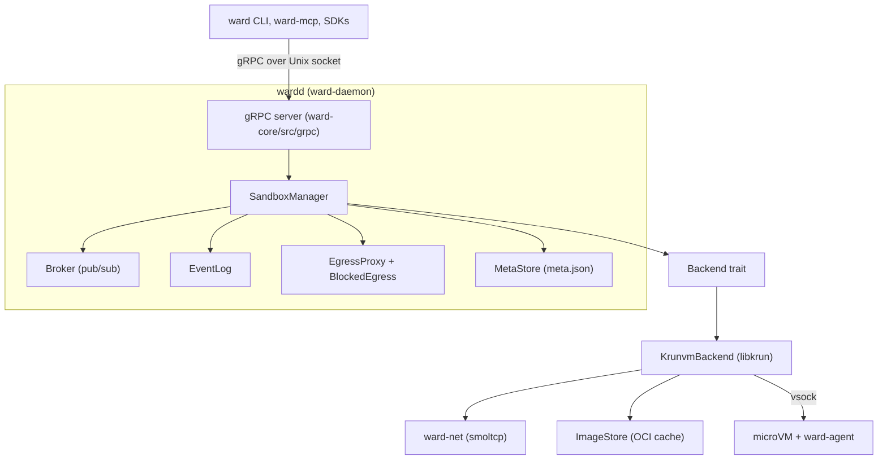

# Architecture

Ward runs each sandbox in its own microVM. A client talks to the `wardd` daemon over gRPC on a Unix socket. The daemon turns each call into work on a `Backend`, which boots and drives the VM.

This page describes the code as it is. The ADRs under [`adr/`](adr/) explain why it has this shape. [`SPEC.md`](SPEC.md) is their table of contents.

## Layers

`ward-runtime` builds the same stack without the gRPC layer. `Runtime::from_config` wires one `Backend`, one `Broker`, one `SandboxManager` and one `VolumeManager`. `wardd` calls it, then puts the gRPC server on top. Embedded SDKs call it directly. Both paths share one wiring, so they can't drift apart.

### Responsibilities

| Layer | Code | Owns |
| --- | --- | --- |
| Clients | `ward-cli`, `ward-mcp`, `sdks/` | Parse user input, call the proto API. No sandbox logic. |
| Transport | `ward-core/src/grpc` | One handler per RPC. Reads the `x-ward-sandbox-token` metadata header and checks it. Maps `ApiError` to gRPC status codes. Serves attach streams. |
| Daemon | `ward-daemon` | Process setup: umask `0077`, logging, metrics, socket mode `0600`, message size caps, concurrency caps, graceful shutdown. |
| Manager | `ward-core/src/sandbox` | Sandbox registry and validation. Also tokens, process records, events, persistence, exited TTL and timeouts. It doesn't touch a VMM directly. |
| Broker | `ward-core/src/comms` | Policy and routing for cross-sandbox messages, plus their audit log. |
| Egress | `ward-core/src/egress`, `ward-net` | Decide which destinations a sandbox reaches, and record refusals. |
| Backend | `ward-core/src/backend` | Everything that needs a VM: boot, exec, copy, stats, snapshots, images. |
| Guest | `ward-agent` | Runs inside the VM. Spawns processes and moves bytes for the backend over vsock. |

The daemon applies three caps before any sandbox logic runs:

- A message decode cap of 1.5 MiB and an encode cap of 2 MiB.
- 100 concurrent streams per connection.
- A global cap of twice `WARD_MAX_SANDBOXES` in-flight RPCs, floored at 2 and capped at 65536.

## The Backend trait

`Backend` is in `ward-core/src/backend/mod.rs`. `SandboxManager` holds an `Arc<dyn Backend>` and knows nothing else about the VMM. That gives three benefits:

- The manager, the gRPC layer and most tests run against a stub. A default `cargo build` has no VM dependency.
- A different VMM (Firecracker, Virtualization.framework) is one new impl, not a rewrite.
- The VMM's types stay out of the API. Everything crossing the trait is a `protocol` type or a plain string.

The trait is async through `#[async_trait]`. That boxes each future and keeps the trait object safe, so the manager needs no generic parameter.

It groups its methods like this:

| Group | Methods |
| --- | --- |
| Lifecycle | `create_sandbox`, `get_sandbox`, `list_sandboxes`, `remove_sandbox`, `adopt_sandbox`, `stop_sandbox`, `start_sandbox`, `count` |
| Images | `image_config`, `resolve_image`, `list_images`, `pull_image`, `commit_sandbox`, `diff_sandbox` |
| Processes | `exec`, `kill_process`, `top`, `stats`, `put_secrets` |
| Files | `copy_to`, `copy_from` |
| Network | `publish_port`, `blocked_egress`, `add_egress_allow` |
| Snapshots | `create_snapshot`, `restore_snapshot`, `list_snapshots`, `snapshot_owner` |

Several methods have a default body, for example `image_config`, `list_images`, `diff_sandbox` and `add_egress_allow`. A backend with no image cache or no policed network inherits the empty answer.

### Add a backend

1. Add a module under `ward-core/src/backend/` and a struct that holds your VMM state.
2. Implement `Backend` for it. Return `BackendError` variants that carry meaning: `NotFound`, `InvalidArgument`, `ResourceExhausted`, `Unavailable`. The manager's `backend_err` maps those to precise API errors. Anything else becomes a generic backend error.
3. Return a `ProcessHandle` from `exec`. Fill `output_rx` with `StreamEvent`s that end in an `Exit` event. Fill `stdin_tx` and `control_tx` when the guest supports them.
4. Gate the module behind a cargo feature if it needs native libraries, as `krunvm` does.
5. Construct it in `ward-runtime/src/lib.rs`, in `Runtime::wire`, where `KrunvmBackend` is built today.
6. Run the manager and gRPC tests against it. They need only the trait.

## The broker

`Broker` in `ward-core/src/comms/broker.rs` is an in-process pub/sub bus. Policy is set once per sandbox at creation.

- **Deny is the default.** `CommunicationMode::Deny` refuses both `publish` and `subscribe` for that sandbox. A denied publish still writes an audit row with `allowed: false`.
- **Group routing.** In `Group` mode a message reaches a subscriber only when both sandboxes are in `Group` mode and carry the same non-empty group name. If either side is `Deny`, or either group is empty or missing, nothing is delivered. `can_communicate` is symmetric.
- **Delivery is lossy.** Each subscription has a buffer of 32 messages. If it's full, the broker drops the message for that subscriber and counts it in `wardd_broker_drop_total`. A slow reader doesn't stall a publisher.
- **Audit log.** Each sandbox keeps its latest 256 entries. A publish writes one row for the publisher with the subscriber count, and one row for each subscriber that received it. `GetCommunicationLog` returns them.
- **Cleanup.** `remove` deregisters the sandbox: its policy and log go, and so do its subscriptions. Closed subscriptions are reaped on the next publish.

Payloads are capped at 1 MiB (`MAX_PUBLISH_PAYLOAD_BYTES`).

## Process lifecycle

Every sandbox has one main process, started when the VM boots. Other commands start as execs.

### Main process

The manager owns the main process's output and exit status, and its stdin. A client reaches it through `Attach` with mode `MAIN_PROCESS`, or `Wait`, `Stop` and `Restart`. Output is buffered, so a late attach replays what it missed. A client that disconnects only detaches. The process keeps running. `replay` attaches are read-only and get no stdin.

### Exec

1. `Exec` validates the command, resolves the user and delivers any secrets. It then calls `Backend::exec`.
2. The manager stores a `ProcessRecord` under the returned pid. It holds the sandbox id, the output receiver and the stdin sender.
3. `StreamOutput` takes the receiver once. A second call fails with "output stream already consumed". A task forwards events to the caller and drops the record when it sees `Exit`, or when the channel closes.
4. `WriteStdin` clones the sender and sends bytes. An empty write is a no-op.
5. `KillProcess` checks ownership, asks the backend to signal, then drops the record.

Every call checks that the pid belongs to the sandbox named in the request. A pid from another sandbox looks like an unknown pid, so pids don't leak across tenants.

### Attach exec

`Attach` with mode `EXEC` starts a new command and binds its I/O to one bidirectional stream. It supports a pty and resize, and signals through `ProcessControl`. If the client goes away, the daemon sends SIGKILL to the command, since no client owns it any more.

### Signals

`ProcessControl::Signal` sends a signal number to a process. `signal_main_process` does the same for the main process. The CLI passes SIGINT and SIGTERM through when it's not in raw terminal mode.

## Images

`ImageStore` (`backend/image.rs`) caches OCI images on disk, one entry per digest. `WARD_MAX_CACHED_IMAGES` caps the count. When the cache is full, a pull evicts old entries.

Eviction spares two kinds of entry:

- **Committed images**, made by `ward commit`.
- **Held images.** `hold(sandbox_id, reference)` records that a sandbox runs a digest. A moved tag doesn't unprotect it, because the hold is on the digest. `release` runs when the sandbox is removed.

`WARD_REGISTRY_ALLOWLIST` limits which registries a pull may contact.

## Copy relay

`ward cp` moves a tar between a client and a guest. The guest is untrusted, so the daemon doesn't pass its bytes through blindly.

- Into a sandbox, the guest checks the tar while it unpacks it.
- Out of a sandbox, `sandbox/copy.rs` relays the guest's tar and checks each header as it goes. Absolute paths, `..`, links that leave the root and special files are refused. Padding after the end marker is limited. A guest that sends nothing for 30 seconds is abandoned.
- Chunks pass through a channel of 4, so a slow client pushes back on the guest.

A failure midway reaches the client as an error item, and the entries already written stay.

## Events

`EventLog` (`sandbox/events.rs`) fans out lifecycle events: `create`, `start`, `die`, `stop`, `destroy`, `update`. It's a broadcast channel of 1024 events plus a history of the same size.

- The manager doesn't wait for a reader. A slow reader loses the oldest events and is told how many it missed.
- `since` replays history, then follows live events. `until` ends the stream.
- Nothing is persisted. A daemon restart clears the log.
- The `Events` RPC takes no sandbox token. See [Deployment](DEPLOYMENT.md#multi-tenant-security).

## Ports and inbound forwarding

`-p` publishes a guest TCP or UDP port on the host. `BackendForwarder` calls `Backend::publish_port`, which opens a host listener. `ward-net/src/inbound.rs` accepts connections and hands each one to the smoltcp task. That task opens a TCP connection from the gateway to the guest and relays both ways. `ward-net/src/inbound_udp.rs` does the same for datagrams.

- TCP and UDP. UDP keeps one flow per host peer and frees it after 60 idle seconds. Egress policy doesn't apply to these flows, because they point toward the guest.
- At most 64 concurrent connections per published port. Further connections close at accept time.
- Without a `HOST_IP` the listener binds `127.0.0.1`.
- A port stays open while the sandbox is exited. It closes on `stop` or `remove`.

## Egress

A sandbox has one of three modes (`EgressMode`):

| Mode | Behavior |
| --- | --- |
| `deny` (default) | No network device in the guest, unless ports are published. |
| `allowlist` | The guest reaches only listed names. |
| `open` | The guest reaches any outbound destination. |

Networking is `ward-net`'s smoltcp stack, set by `WARD_NETWORK_BACKEND` (`smoltcp` by default, or `none`). Allowlist mode needs smoltcp: the manager refuses it when the network backend is `none`.

In allowlist mode the stack answers DNS with REFUSED for names off the list, and checks each flow. `EgressProxy` keeps the policy and its decision log. `BlockedEgress` records refused destinations, at most 256 hosts per sandbox, least recently seen out first. The record outlives the sandbox's run and goes away on `remove`.

`ward egress suggest` reads that record. With `--apply` it calls `AddEgressAllow`. The manager checks the names, saves the new list to `meta.json`, tells the live backend, and emits an `update` event. The list holds at most 256 names. `deny` sandboxes must be recreated, and `open` sandboxes have nothing to add.

## Secrets

`--secret` on `run` and `exec` sends file contents with the request. The manager validates them (16 files, 64 KiB each), takes them out of the stored options, and calls `Backend::put_secrets`. The agent writes them under `/run/secrets` as mode 0400 files on a tmpfs, owned by the command's user. The daemon holds the bytes in memory only. They don't reach `meta.json`, events, inspect output or logs.

Because the content isn't stored, a sandbox created with `--secret` can't be started again. `start` and `restart` fail, and you recreate it.

## Tokens and persistence

`create` mints a random capability token and returns it once. The manager stores only its SHA-256 hash, compared in constant time. Later calls present the token in the `x-ward-sandbox-token` header. `get` and `list` redact it.

`MetaStore` writes one `meta.json` per sandbox under `<data>/sandboxes`. At startup `restore` reloads them. A sandbox that was running comes back stopped, because no VM outlives the daemon. A clean shutdown removes every sandbox first, so records survive only a crash or a kill.

## End reasons

When the main process ends, the manager records an `EndReason` in `State.Reason`, and in the `die` event:

| Reason | Meaning |
| --- | --- |
| `exited` | The main process ended by itself. |
| `signal` | A signal ended it. |
| `oom` | SIGKILL plus a guest OOM kill during the run. Sets `OOMKilled`, exit code 137. |
| `timeout` | The sandbox hit `--timeout`. It's removed, so only the `die` event carries this value. |
| `egress-policy` | Defined, but not recorded. Egress policy blocks connections and doesn't end a sandbox. |

An exited sandbox is removed after its `--exited-ttl`, or after `WARD_EXITED_TTL_SECS` when the sandbox sets none.
